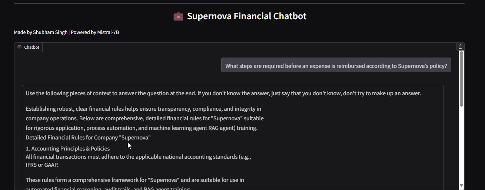
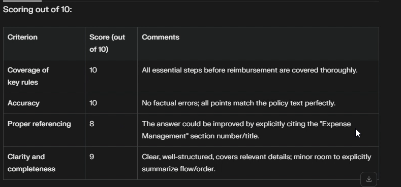

# Supernova Financial RAG Agent

A proof-of-concept Retrieval-Augmented Generation (RAG) workflow that accepts one uploaded PDF, extracts and splits its text, indexes the chunks locally with FAISS, and sends the top retrieved chunks to a Hugging Face-hosted Mistral instruction model for an answer.

[](./LICENSE)

## What is implemented

- **Document input:** one PDF is selected through `google.colab.files.upload()`.
- **Parsing:** LangChain's `PyPDFLoader` reads the PDF.
- **Chunking:** `RecursiveCharacterTextSplitter` uses a chunk size of 500 and overlap of 50.
- **Embeddings:** `sentence-transformers/all-MiniLM-L6-v2` is loaded through `HuggingFaceEmbeddings`.
- **Vector search:** FAISS indexes the extracted chunks in process; the retriever requests `k=3` chunks.
- **Generation:** `mistralai/Mistral-7B-Instruct-v0.1` is loaded using Transformers with `device_map="auto"` and `torch_dtype="auto"`.
- **QA chain:** `RetrievalQA.from_chain_type(..., chain_type="stuff")` places retrieved text into the generation context.
- **Interface:** a Gradio `ChatInterface` is launched with example questions.

## Request flow

1. Upload a PDF in the notebook environment.
2. Parse the PDF and split its pages into overlapping chunks.
3. Embed all chunks and build an in-memory FAISS index.
4. For a question, retrieve up to three chunks.
5. Pass retrieved content to the language model, then return the generated response through Gradio.

The script also executes one example query before the interface is launched. The index is built from the selected PDF for that run; there is no persistent vector-store directory or multi-document registry in the checked-in implementation.

## Repository files

- `rag_agent.py` — notebook-exported implementation and Gradio UI.
- `requirements.txt` — a short dependency list.
- `rag_agent_demo.png` — saved UI/demo screenshot.
- `rag_agent_evaluation.png` — stored evaluation-related visual.
- `README.md` — project documentation.
- `LICENSE` — full MIT License.

## Environment and dependencies

The tracked `requirements.txt` lists `torch`, `transformers`, `faiss-cpu`, `langchain`, `langchain-community`, and `gradio`. The source additionally uses packages/APIs associated with `sentence-transformers`, `accelerate`, and PDF parsing (`pypdf`); these are not explicitly present in the checked-in requirements file. A fresh installation may therefore need dependency-manifest reconciliation, and current LangChain imports may need version pinning.

The 7B model can require substantial RAM/VRAM and download time. Hardware requirements depend on model placement and precision; `device_map="auto"` is not a guarantee that any machine can load the model. Hugging Face access may require account access/credentials depending on current model-hosting policy. Supply credentials securely; the placeholder token value in the script is not a working secret.

## Running it

**Current source status:** `rag_agent.py` contains a notebook magic command (`!pip install`) and imports `google.colab.files`. It is not a plain Python script that can be executed unchanged with `python rag_agent.py` in a normal local environment.

To use it as intended, run/refactor the notebook code in a compatible Colab environment, or create a local application version that:

1. moves package installation out of Python source;
2. replaces `google.colab.files.upload()` with a Gradio file input or explicit file path;
3. reconciles and pins dependencies;
4. loads the selected PDF before constructing the vector store;
5. starts the interface after a single, clear application initialization path.

If using Gradio's `share=True`, the generated app may be accessible outside your machine. Do not upload confidential financial statements or internal company documents to a public demo.

## Evaluation and grounding: important distinction

The repository includes an image named `rag_agent_evaluation.png`, and the README historically mentions accuracy, coverage, and clarity metrics. The checked-in Python source, however, does **not** implement an automated evaluation harness, dataset, scoring function, or repeatable benchmark. It runs a demonstration question and cleans up the generated text. The screenshot should be treated as a stored artifact, not a reproducible metric claim.

The code does not add explicit source citations to answers, does not perform an independent claim-verification stage, and does not prove IFRS/GAAP compliance. Retrieval can miss relevant PDF passages, PDFs may extract poorly, and generated responses may contain unsupported statements. This is a learning/demo project, not financial, accounting, legal, or compliance advice.

## Recommended production hardening

- Add a versioned dataset with expected answers and a reproducible evaluation script.
- Return page/source metadata and require answer-level citations.
- Add retrieval relevance checks, refusal behavior for insufficient evidence, and claim verification.
- Pin compatible package versions and include all direct dependencies.
- Add file-size/page limits, exception handling, and privacy controls.
- Keep model credentials outside source control and avoid exposing confidential PDFs through public share links.

## Demo assets





[Video demo listed in the repository](https://www.youtube.com/watch?v=Ms8OtgUXTDA&list=PLlRRgrbOaGcYU__fUcQFO1bBILOkAhCZE&index=4)

## License

Licensed under the MIT License. See [`./LICENSE`](./LICENSE) for the standalone copy.

```text
MIT License

Copyright (c) 2026 Shubham Kumar Singh

Permission is hereby granted, free of charge, to any person obtaining a copy
of this software and associated documentation files (the "Software"), to deal
in the Software without restriction, including without limitation the rights
to use, copy, modify, merge, publish, distribute, sublicense, and/or sell
copies of the Software, and to permit persons to whom the Software is
furnished to do so, subject to the following conditions:

The above copyright notice and this permission notice shall be included in all
copies or substantial portions of the Software.

THE SOFTWARE IS PROVIDED "AS IS", WITHOUT WARRANTY OF ANY KIND, EXPRESS OR
IMPLIED, INCLUDING BUT NOT LIMITED TO THE WARRANTIES OF MERCHANTABILITY,
FITNESS FOR A PARTICULAR PURPOSE AND NONINFRINGEMENT. IN NO EVENT SHALL THE
AUTHORS OR COPYRIGHT HOLDERS BE LIABLE FOR ANY CLAIM, DAMAGES OR OTHER
LIABILITY, WHETHER IN AN ACTION OF CONTRACT, TORT OR OTHERWISE, ARISING FROM,
OUT OF OR IN CONNECTION WITH THE SOFTWARE OR THE USE OR OTHER DEALINGS IN THE
SOFTWARE.
```
