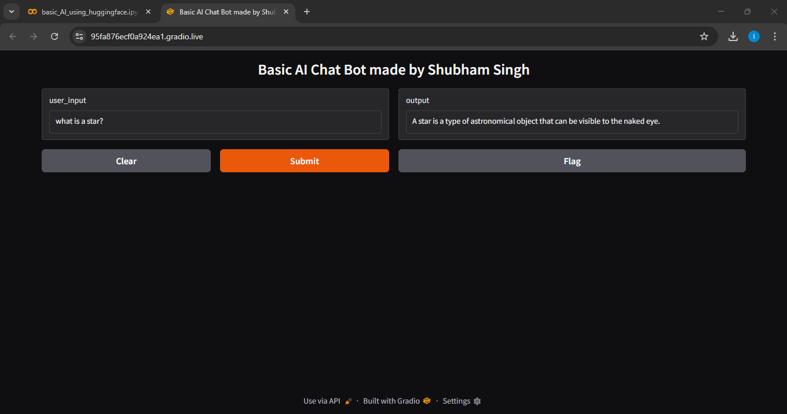

# BlenderBot 400M Distill Chatbot

A small conversational demo using Hugging Face's `facebook/blenderbot-400M-distill` sequence-to-sequence model behind a Gradio text interface.

[](./LICENSE)

## Features and behavior

- Loads a pretrained BlenderBot tokenizer and sequence-to-sequence model from Hugging Face.
- Accepts one text input and returns a decoded response with special tokens removed.
- Generation configuration in the checked-in source: `max_new_tokens=50`, `repetition_penalty=1.2`, sampling enabled, `top_k=50`, and `top_p=0.95`.
- Uses Gradio to expose a simple input/output interface.
- Keeps a Python list named `conversation_history` and appends each user message and model response.

## Important behavior detail: history is not model context

Although `conversation_history` is populated, it is not passed into `tokenizer(...)` or `model.generate(...)`. Each inference call uses only the current user input, so the model does not receive earlier turns as conversational context. The existing history variable is bookkeeping only; it does not implement conversational memory.

## Files

- `basic_ai_using_huggingface.py` — model loading, generation, and Gradio interface.
- `requirements.txt` — declares `transformers==4.30.2`, `torch`, and `gradio`.
- `basic_AI_using_huggingface_image.png` — screenshot of the interface.
- `README.md` and `LICENSE` — documentation and license.

## Model and dependencies

Model identifier: `facebook/blenderbot-400M-distill`.

The model weights and tokenizer are downloaded from Hugging Face on first use and cached according to the local Hugging Face cache configuration. Startup time and memory use depend on the environment. The source does not explicitly configure a GPU device, so do not promise GPU acceleration from the code as written.

The source declares `!pip install transformers==4.30.2 torch gradio`. That exclamation-prefixed install statement is notebook magic, not valid standard Python syntax. It must be run in a notebook or removed before running the file with a local Python interpreter.

## Running

From this project directory, install declared dependencies:

```bash
python -m pip install -r requirements.txt
```

Then run the adapted Python file after removing the notebook-only `!pip` line:

```bash
python basic_ai_using_huggingface.py
```

The script calls `launch(share=True)`, which may create a publicly reachable Gradio link. Use that only for non-sensitive demo input. If running on a shared host, configure access controls and the desired sharing behavior explicitly.

## Limitations

- No saved fine-tuned weights are provided; the code loads a public pretrained model.
- No explicit conversation history is incorporated into generation.
- No model evaluation or safety filter is implemented.
- There are no automated tests or benchmark metrics in this project directory.
- Output quality can vary with sampling and may be inaccurate or inappropriate for some inputs.

## Demo



[Video demo listed in the repository](https://www.youtube.com/watch?v=3bno8Z1ad38&list=PLlRRgrbOaGcYU__fUcQFO1bBILOkAhCZE)

## License

Licensed under the MIT License. See [`./LICENSE`](./LICENSE) for the standalone copy.

```text
MIT License

Copyright (c) 2026 Shubham Kumar Singh

Permission is hereby granted, free of charge, to any person obtaining a copy
of this software and associated documentation files (the "Software"), to deal
in the Software without restriction, including without limitation the rights
to use, copy, modify, merge, publish, distribute, sublicense, and/or sell
copies of the Software, and to permit persons to whom the Software is
furnished to do so, subject to the following conditions:

The above copyright notice and this permission notice shall be included in all
copies or substantial portions of the Software.

THE SOFTWARE IS PROVIDED "AS IS", WITHOUT WARRANTY OF ANY KIND, EXPRESS OR
IMPLIED, INCLUDING BUT NOT LIMITED TO THE WARRANTIES OF MERCHANTABILITY,
FITNESS FOR A PARTICULAR PURPOSE AND NONINFRINGEMENT. IN NO EVENT SHALL THE
AUTHORS OR COPYRIGHT HOLDERS BE LIABLE FOR ANY CLAIM, DAMAGES OR OTHER
LIABILITY, WHETHER IN AN ACTION OF CONTRACT, TORT OR OTHERWISE, ARISING FROM,
OUT OF OR IN CONNECTION WITH THE SOFTWARE OR THE USE OR OTHER DEALINGS IN THE
SOFTWARE.
```
