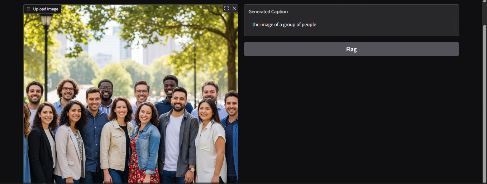
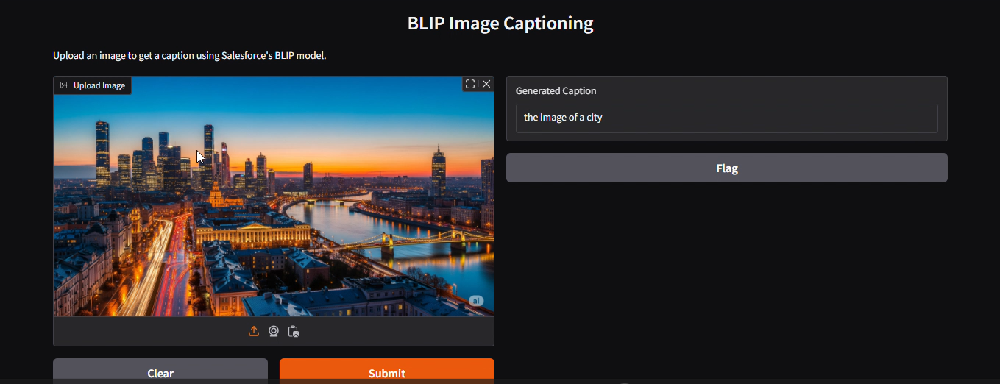
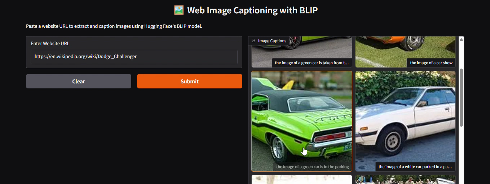

# BLIP Image Captioning

An image-captioning demonstration built around Salesforce's `Salesforce/blip-image-captioning-base` model from Hugging Face. The checked-in script contains three sequential demonstration sections: a Colab file-upload example, a Gradio upload UI, and a URL-based webpage image gallery.

[](./LICENSE)

## Capabilities in the source

### Image upload
- Loads a BLIP processor and conditional-generation model.
- Uses a text prompt (`"the image of"`) with the input image.
- Generates up to a configured maximum length and decodes the output caption.
- Exposes an upload-based Gradio interface.

### Website image gallery
- Fetches HTML from a supplied website URL using `requests`.
- Parses HTML image elements using BeautifulSoup.
- Resolves a basic set of relative image URL forms.
- Attempts to download and caption up to 10 images per page.
- Returns successful image/caption pairs in a Gradio gallery.

## Model and dependencies

Model: `Salesforce/blip-image-captioning-base`.

The checked-in `requirements.txt` lists Transformers 4.30.2, Torch, Gradio, Requests, Pillow, and BeautifulSoup4. The source's notebook install command instead requests Transformers 4.38.2, Torch 2.2.1, Gradio 5.23.2, and additional packages. This is a dependency-version mismatch. The script also imports LangChain only as an unused placeholder, and the requirements file does not list that package. For reproducible use, choose and pin a tested package set, then make the manifest and install instructions agree.

## Execution status and steps

**The source is a Colab notebook export, not a clean local executable as committed.** It begins with `!pip install` and `google.colab.files.upload()`, then contains multiple model loads and interface launches in one file. A regular local Python interpreter will fail on the notebook magic syntax; the upload section is also tied to Google Colab.

A local refactor should remove notebook-only statements and the initial one-off upload section, load the BLIP model once, and expose the two intended Gradio modes (file upload and URL gallery) through one application entry point.

After this refactor, in the project directory:

```bash
python -m pip install -r requirements.txt
python image_captioning_using_huggingface.py
```

The commands above describe the intended adapted local workflow; they are not a claim that the current committed file executes unchanged outside Colab.

## Security and privacy considerations

The URL-based gallery fetches a user-supplied website and then retrieves image URLs found in its HTML. The current code has request timeouts and a limit of 10 images, but it does not implement a strict hostname allow-list, private-address blocking, response-size limits, MIME validation before decoding, or a hardened SSRF defense. Do not expose this endpoint as a production service without those controls. Treat webpage content and downloaded images as untrusted inputs. Images uploaded to a shared Gradio endpoint may be visible to the endpoint operator and potentially accessible through its sharing configuration.

## Files and stored outputs

- `image_captioning_using_huggingface.py` — Colab-exported multi-section implementation.
- `requirements.txt` — project dependencies as currently declared.
- `image_captioning_image_1.png`, `image_captioning_image_2.png` — image-upload demo screenshots.
- `web_based_image_captioning.png` — URL-gallery screenshot.
- `README.md`, `LICENSE` — documentation and license.

## Results and evaluation

The tracked PNG files are example output/screenshots. The source does not define a caption-quality benchmark, human evaluation set, or automated accuracy metric. A generated caption is a model prediction and can omit details, misidentify objects, or describe a scene incorrectly.

## Demo







[Video demo listed in the repository](https://www.youtube.com/watch?v=VHFnyVZX7z4&list=PLlRRgrbOaGcYU__fUcQFO1bBILOkAhCZE&index=2)

## License

Licensed under the MIT License. See [`./LICENSE`](./LICENSE) for the standalone copy.

```text
MIT License

Copyright (c) 2026 Shubham Kumar Singh

Permission is hereby granted, free of charge, to any person obtaining a copy
of this software and associated documentation files (the "Software"), to deal
in the Software without restriction, including without limitation the rights
to use, copy, modify, merge, publish, distribute, sublicense, and/or sell
copies of the Software, and to permit persons to whom the Software is
furnished to do so, subject to the following conditions:

The above copyright notice and this permission notice shall be included in all
copies or substantial portions of the Software.

THE SOFTWARE IS PROVIDED "AS IS", WITHOUT WARRANTY OF ANY KIND, EXPRESS OR
IMPLIED, INCLUDING BUT NOT LIMITED TO THE WARRANTIES OF MERCHANTABILITY,
FITNESS FOR A PARTICULAR PURPOSE AND NONINFRINGEMENT. IN NO EVENT SHALL THE
AUTHORS OR COPYRIGHT HOLDERS BE LIABLE FOR ANY CLAIM, DAMAGES OR OTHER
LIABILITY, WHETHER IN AN ACTION OF CONTRACT, TORT OR OTHERWISE, ARISING FROM,
OUT OF OR IN CONNECTION WITH THE SOFTWARE OR THE USE OR OTHER DEALINGS IN THE
SOFTWARE.
```
