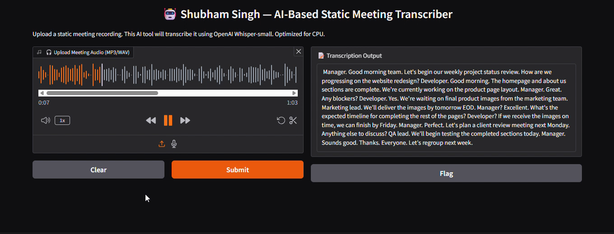

# Meeting Transcriber — Whisper Small

A Gradio demonstration for transcribing uploaded meeting audio with Hugging Face Transformers' automatic-speech-recognition pipeline and `openai/whisper-small`.

[](./LICENSE)

## Processing flow

1. The Gradio `Audio` component receives an audio file path.
2. A Transformers ASR pipeline, initialized once at startup, processes the recording.
3. The UI returns the `text` value from the pipeline result.

The pipeline is configured with `chunk_length_s=30` and `return_timestamps=True`. However, `transcribe_audio()` returns only `result["text"]`, so any timestamp/chunk metadata returned by the pipeline is discarded from the UI output. This should be described as transcript text output, not a timestamped transcript interface.

## Model and dependencies

- Model: `openai/whisper-small`.
- Main libraries: Transformers, PyTorch, Torchaudio, Gradio.
- `requirements.txt` pins Transformers to 4.30.2 and lists `torch`, `torchaudio`, and `gradio`.
- The Python source begins with the notebook command `!pip install -q gradio transformers torchaudio`; this syntax is not valid in a standard Python file. The script is notebook-exported and needs that line removed when launched locally.

The model is downloaded on first use and may require significant disk, memory, and processing time. GPU acceleration can help, but the script does not explicitly select a device. Actual speed depends on the runtime and audio length. Audio decoding can also depend on the installed runtime's media/audio backend.

## Installation and execution

From this directory:

```bash
python -m pip install -r requirements.txt
```

Before local execution, remove the notebook-only `!pip` line, then run:

```bash
python gradiobasedmeetingtranscriber.py
```

The current code calls `interface.launch()` without `share=True`; the source therefore does not explicitly request a public share link. A local Gradio address is expected when the application starts successfully.

## Input and output

- **Input:** uploaded static meeting audio. The interface label lists MP3/WAV, but real support depends on Gradio and the audio decoder environment.
- **Output:** transcript text.
- **Not implemented in the current UI:** speaker diarization, speaker labels, editable transcripts, downloadable transcript files, or displaying the available timestamp metadata.

## Reliability, privacy, and limitations

- The source does not include an accuracy benchmark or word error rate evaluation.
- Transcription may be incorrect for noisy recordings, overlapping speech, specialist vocabulary, or unsupported language/accent conditions.
- No explicit upload-duration/size limits, persistent storage policy, or deletion workflow is implemented in this small demo.
- Treat meeting recordings and transcripts as potentially confidential; use only approved data and a properly secured host.

## Project files

- `gradiobasedmeetingtranscriber.py` — ASR pipeline and Gradio UI.
- `requirements.txt` — dependency list.
- `AI_based_meeting_transcriber.png` — demo screenshot.
- `README.md` and `LICENSE` — documentation and license.

## Demo



[Video demo listed in the repository](https://www.youtube.com/watch?v=sdGgobRCUFw&list=PLlRRgrbOaGcYU__fUcQFO1bBILOkAhCZE&index=3)

## License

Licensed under the MIT License. See [`./LICENSE`](./LICENSE) for the standalone copy.

```text
MIT License

Copyright (c) 2026 Shubham Kumar Singh

Permission is hereby granted, free of charge, to any person obtaining a copy
of this software and associated documentation files (the "Software"), to deal
in the Software without restriction, including without limitation the rights
to use, copy, modify, merge, publish, distribute, sublicense, and/or sell
copies of the Software, and to permit persons to whom the Software is
furnished to do so, subject to the following conditions:

The above copyright notice and this permission notice shall be included in all
copies or substantial portions of the Software.

THE SOFTWARE IS PROVIDED "AS IS", WITHOUT WARRANTY OF ANY KIND, EXPRESS OR
IMPLIED, INCLUDING BUT NOT LIMITED TO THE WARRANTIES OF MERCHANTABILITY,
FITNESS FOR A PARTICULAR PURPOSE AND NONINFRINGEMENT. IN NO EVENT SHALL THE
AUTHORS OR COPYRIGHT HOLDERS BE LIABLE FOR ANY CLAIM, DAMAGES OR OTHER
LIABILITY, WHETHER IN AN ACTION OF CONTRACT, TORT OR OTHERWISE, ARISING FROM,
OUT OF OR IN CONNECTION WITH THE SOFTWARE OR THE USE OR OTHER DEALINGS IN THE
SOFTWARE.
```
