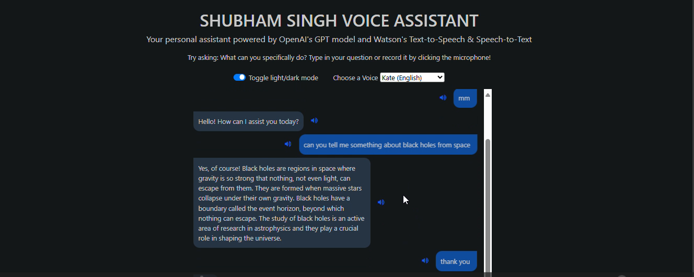

# Voice Assistant — Watson STT/TTS + OpenAI Responses

A small Flask backend demonstrating a voice-assistant round trip: receive audio and ask a Watson Speech-to-Text service to transcribe it; send a user message to an OpenAI chat model; then pass the assistant response to a Watson Text-to-Speech service and return text plus base64-encoded audio.

[](./LICENSE)

## Implemented API flow

- `GET /` calls `render_template('index.html')`.
- `POST /speech-to-text` treats the raw request body as audio bytes and calls the Watson STT sandbox endpoint, using the `en-US_Multimedia` model.
- `POST /process-message` reads `userMessage` and `voice` from JSON, calls OpenAI using the `gpt-3.5-turbo` model name, requests synthesized speech, and returns `openaiResponseText` plus base64-encoded `openaiResponseSpeech`.
- The Flask server binds to `0.0.0.0` on port `8000`.

The IBM endpoints in `worker.py` use the `labs.skills.network` domain and are described in the source as lab/sandbox services. Their current availability and production suitability are not verified here. The OpenAI Python client relies on its normal credential configuration (typically an environment variable such as `OPENAI_API_KEY`).

## Important missing file

The current GitHub file inventory does **not** contain `templates/index.html`, although `server.py` attempts to render it for `GET /`. Consequently, the backend can start but the home-page request will fail unless that template is added to the repository. This documentation does not invent or supply a replacement frontend file.

## Dependencies

`requirements.txt` declares Flask, flask-cors, openai, and requests. Runtime also requires working network access and credentials/configuration for the external services. Use a virtual environment and keep API keys out of source control.

## Run and test

From this directory:

```bash
python -m pip install -r requirements.txt
# Set the API credential in the environment before using /process-message.
python server.py
```

The server listens on port 8000. It binds to all interfaces (`0.0.0.0`), so do not expose it on a public or shared network without changing the bind address and adding authentication, request validation, rate limits, and appropriate deployment controls. The root page also requires the missing template.

The source's API contracts can be tested separately once the required template and service configuration are available:

- `POST /speech-to-text`: raw audio bytes in the request body; expects a JSON response with `text`.
- `POST /process-message`: JSON body with `userMessage` and `voice`; returns text and base64 audio fields.

## Security and operational limitations

- **No authentication/authorization** is implemented on the routes.
- **CORS is permissive:** `origins: "*"` is configured across routes.
- **No explicit request timeout or comprehensive HTTP error handling** is provided for Watson API requests.
- **User content may be logged:** `server.py` and `worker.py` print request messages and external API responses.
- **Audio and text are sent to external providers:** do not use confidential content without appropriate permission and data-processing review.
- **Model availability:** `gpt-3.5-turbo` is hard-coded. Provider/model availability can change and must be checked before current deployment; it is not configurable through an environment variable in this source.
- The README previously mentioned port 5000; the actual source uses port 8000.

## Files

- `server.py` — Flask routes and server startup.
- `worker.py` — STT, response generation, and TTS integration.
- `requirements.txt` — Python dependencies.
- `voice_assistant.png` — stored demo screenshot.
- `README.md` and `LICENSE` — documentation and license.

## Demo



[Video demo listed in the repository](https://www.youtube.com/watch?v=-BZwDb9a9pk&list=PLlRRgrbOaGcYU__fUcQFO1bBILOkAhCZE&index=5)

## License

Licensed under the MIT License. See [`./LICENSE`](./LICENSE) for the standalone copy.

```text
MIT License

Copyright (c) 2026 Shubham Kumar Singh

Permission is hereby granted, free of charge, to any person obtaining a copy
of this software and associated documentation files (the "Software"), to deal
in the Software without restriction, including without limitation the rights
to use, copy, modify, merge, publish, distribute, sublicense, and/or sell
copies of the Software, and to permit persons to whom the Software is
furnished to do so, subject to the following conditions:

The above copyright notice and this permission notice shall be included in all
copies or substantial portions of the Software.

THE SOFTWARE IS PROVIDED "AS IS", WITHOUT WARRANTY OF ANY KIND, EXPRESS OR
IMPLIED, INCLUDING BUT NOT LIMITED TO THE WARRANTIES OF MERCHANTABILITY,
FITNESS FOR A PARTICULAR PURPOSE AND NONINFRINGEMENT. IN NO EVENT SHALL THE
AUTHORS OR COPYRIGHT HOLDERS BE LIABLE FOR ANY CLAIM, DAMAGES OR OTHER
LIABILITY, WHETHER IN AN ACTION OF CONTRACT, TORT OR OTHERWISE, ARISING FROM,
OUT OF OR IN CONNECTION WITH THE SOFTWARE OR THE USE OR OTHER DEALINGS IN THE
SOFTWARE.
```
